# Angels95 — AngelTech Engine


[](https://github.com/TribeWarez/Angels-95/releases/latest)
[](https://sourceforge.net/projects/angels-95/files/latest/download)
[](https://github.com/TribeWarez/Angels-95/actions/workflows/ci.yml)


Angels95 is a **multiplayer game world** built on **AngelTech** — the engine that
began life as the OmegaTech Engine. It is a persistent, server-authoritative realm
where players explore partitioned worlds, collect power-ups, level up, and fight
NPCs alongside other connected players.

**Repository:** [github.com/TribeWarez/Angels-95](https://github.com/TribeWarez/Angels-95)

Built on [raylib](https://www.raylib.com/) 5.5 with PS1-inspired retro
aesthetics, a custom **OZONE** world format, a
**LightningScript** entity-scripting language, a Win32-native level editor
(`AngelEd`), and a dedicated standalone server (`AngelServ`) with no raylib
dependency.


**Download:** [SourceForge](https://sourceforge.net/projects/angels-95/files/latest/download)
· [GitHub Releases](https://github.com/TribeWarez/Angels-95/releases/latest)
· [Forum](https://angels95.tribewarez.com)

Windows users should grab the **`Angels95-Setup-<tag>.exe`** installer (a single
self-contained setup that installs the client, the `AngelEd` editor and the
servers with all packaged game data), or the **`System-<tag>.zip`** full bundle.
Linux users should grab the **`System-<tag>-linux-x86_64.tar.gz`** bundle (client +
servers + packaged game data; extract and run `System/run.sh`). The per-binary
assets (`Angels95-<tag>-windows-x86_64.exe`, the Linux client binary,
`AngelEd-<tag>-windows-x86_64.exe`) carry **no game data** and error with
"GameData/ dir is missing" unless placed inside a `System/` bundle or a source
checkout — the server binaries (`AngelServ`/`AngelMaster`/`OzPack`) are
self-contained and need a `GameData/` checkout to serve.

---

## Community — Forum

**→ [angels95.tribewarez.com](https://angels95.tribewarez.com)**

The Angels95 community network runs on **AETHERNET**, the project's own forum
(opened September 2026). It is the place to **discuss the game, report bugs and
drop maps** — the whole network can see what you post, so keep it clean.

- **Bugs** — crashes, broken maps, multiplayer problems. Include the build tag
  from the title footer (`b111`, …) and what you were doing.
- **Maps & content** — `.ozone` worlds, `.ozpak` packages, screenshots.
- **Everything else** — feedback, server hosting, feature ideas.

The [GitHub issue tracker](https://github.com/TribeWarez/Angels-95/issues) still
works for filing a bug in the open; the forum is where the community gathers.
`angels95.tribewarez.com` also serves the master server the client browses with
(**Multiplayer → Join → Source: Internet**).

---

## Showcase

All shots captured in-engine via `--shot` mode (PS1-style, HUD-free). The six
curated showcase worlds come first, then the campaign arc added in b101 and
rebuilt in b111 — two frames each, taken at the spawn and at the landmark the
level is built around.


### Editor 

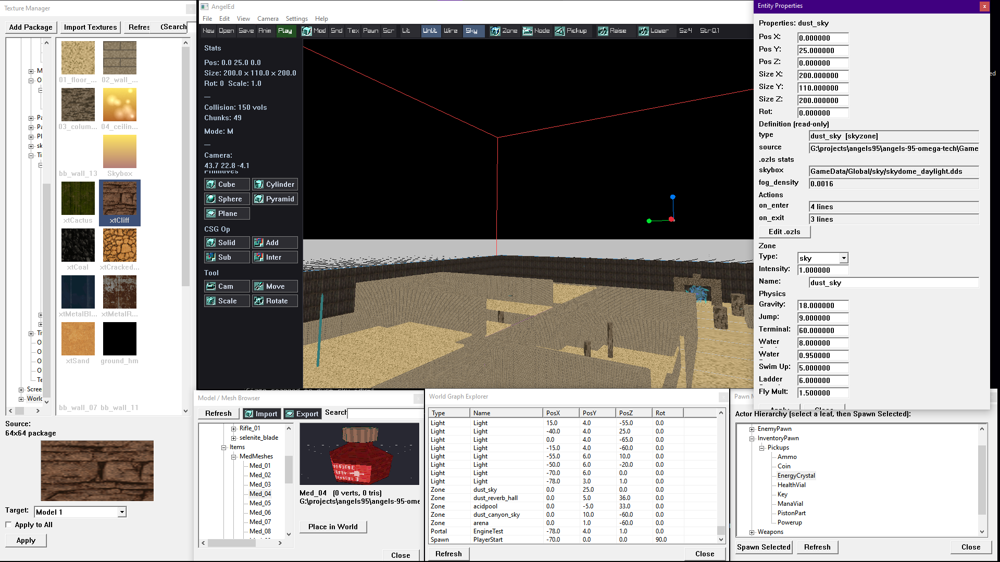
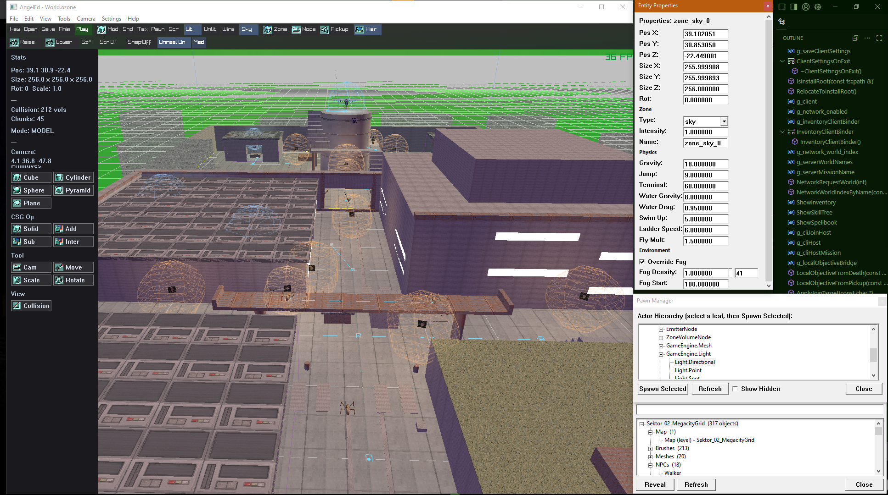

### Engine Test


### Sektor 01 — SilentPines

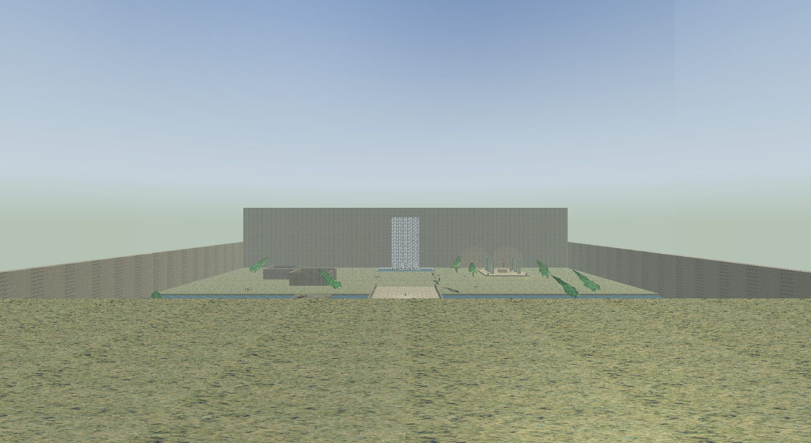
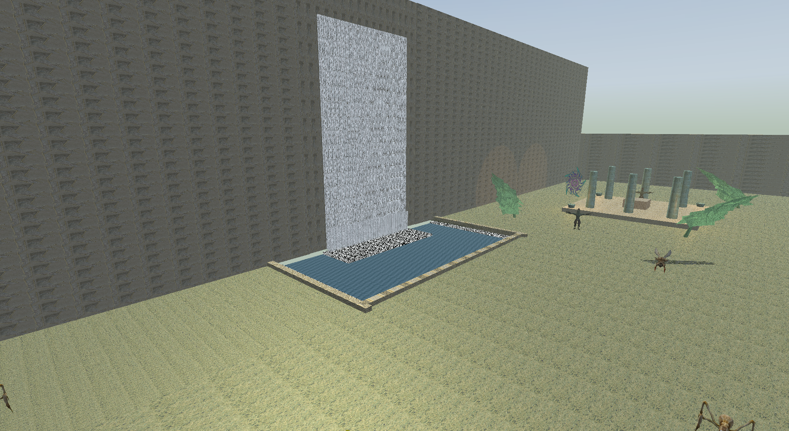
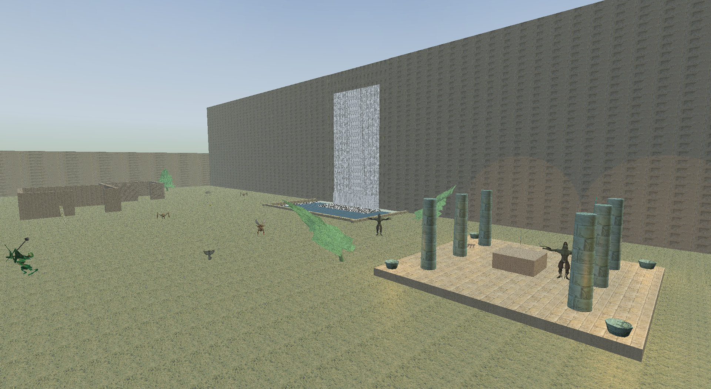

### KryoArchipel — Dusk Falls

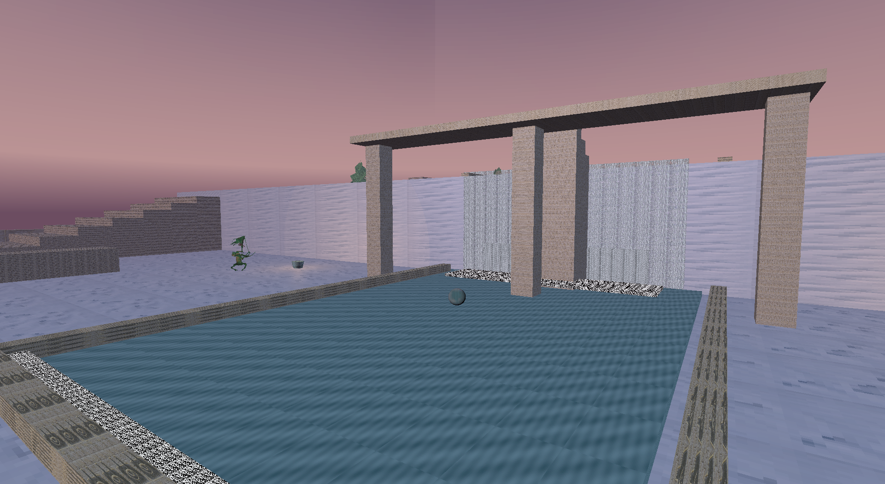
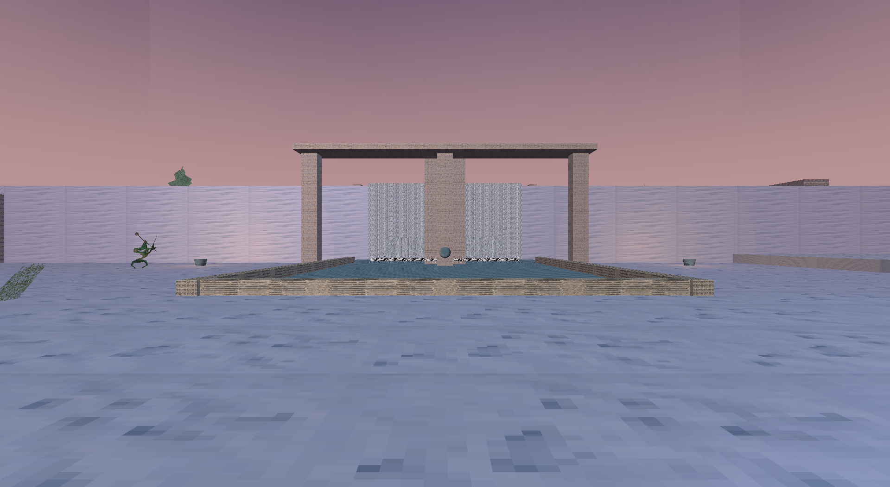
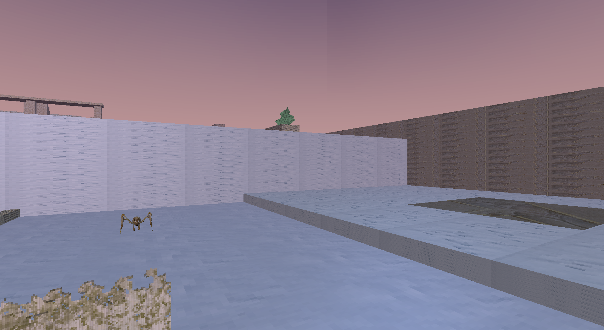

### Refinery Complex 02B
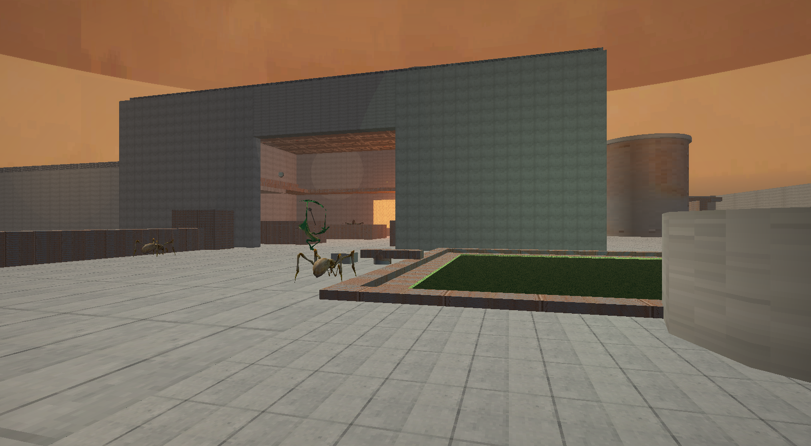
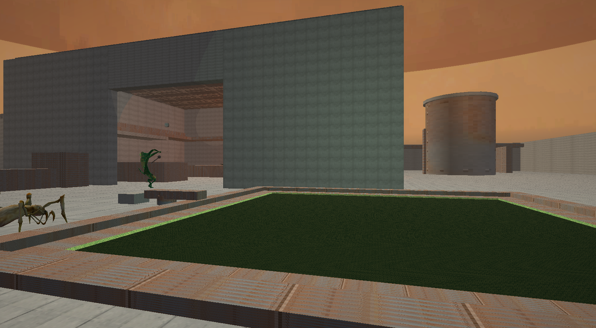

### Digital Purgatory

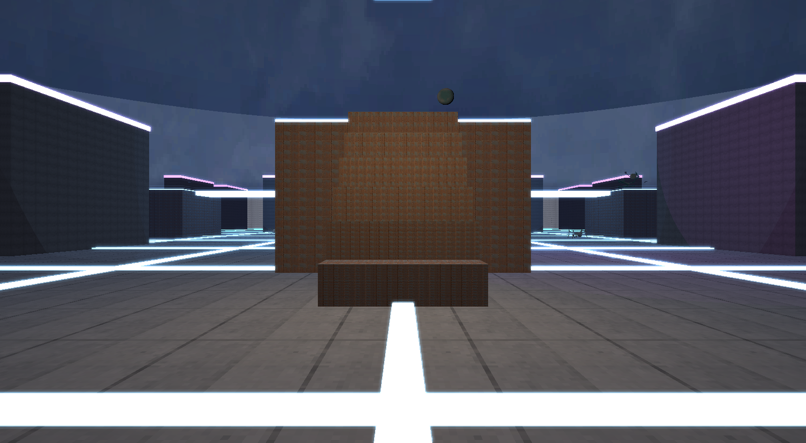
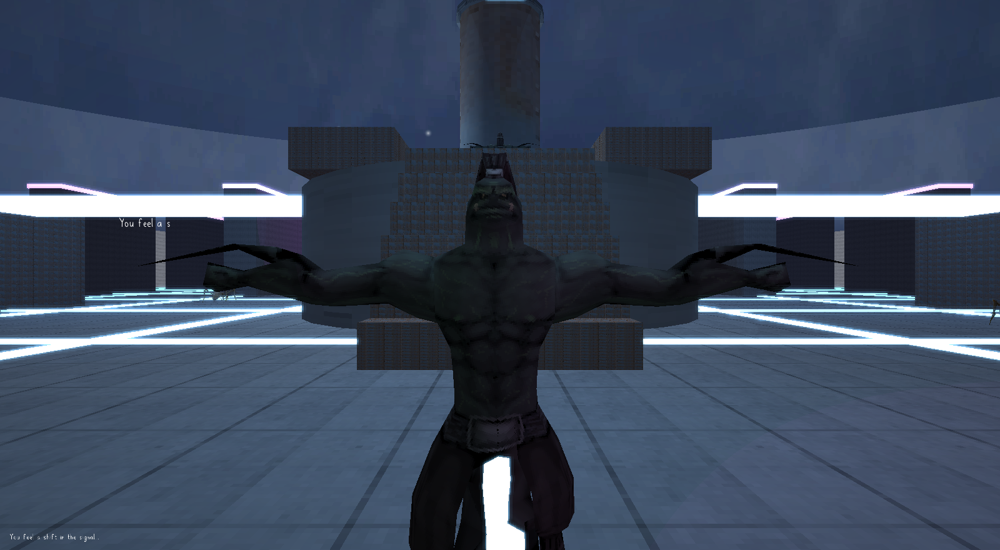

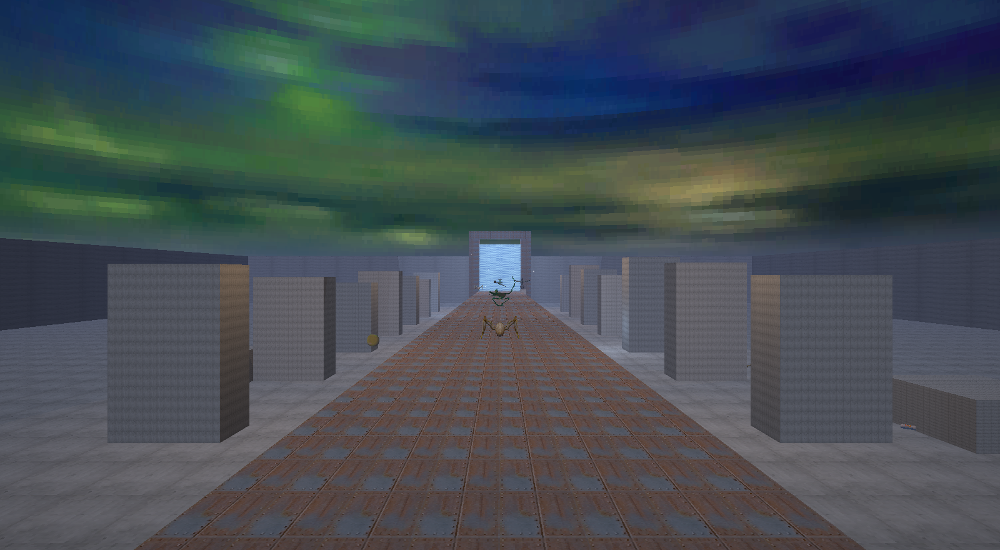
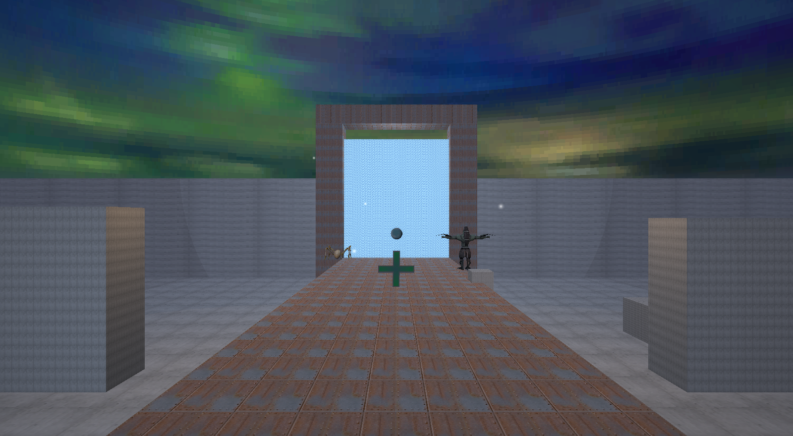

---

## Features

- **A 14-world campaign arc (b101, rebuilt in b111)** — one portal chain across
  five Sefirot sectors with objectives, a campaign save and a campaign Host/Join
  pane. Eleven of those worlds were placeholder rooms until b111 and are now
  authored levels with their own tileset, skyzone, patrol graph and encounter
  design; `Sektor_02` and `Sektor_03` are two-district maps with two routes each.
  The design brief for every level, plus the two audits that verify reachability
  and the portal chain, live in [`Wiki/World-Design-Pass.md`](Wiki/World-Design-Pass.md).
- **Two outdoor campaign maps (b101)** — `Sektor_01_SilentPines` (forested
  gorge: cliff-top arrival, stepped descent, river and bridge, waterfall,
  shrine ruins) and `KryoArchipel_Severny` / Dusk Falls (three dusk cascade
  terraces, ruined aqueduct, stepping stones), plus `Aethelgard_Ruins`
  promoted from the tech demo into a playable mission world.
- **Sky and water rendering (b101)** — the sky samples its vertical gradient
  from **world elevation** instead of the quad texcoord, so the six skybox
  faces agree at every corner (corner steps fell from 33–40 colour levels to
  1–5); deterministic generators produce the pool, waterfall-streak and foam
  textures, and every cascade gets an impact band, a faster churn wall and
  shore foam.
- **Dedicated server** — UDP multiplayer, HTTP map API and `/status`, LAN
  discovery (UDP `27100`) plus internet discovery via `AngelMaster` heartbeats;
  runs headless on Linux or Windows.
- **CSG worlds** — `OZONE` primitive brush format (`add`/`sub`/`intersect`,
  box/cyl/sph/pyr/pln), per-brush `texScale*`/`texOffset*`/`texPath` and
  `name=` zone labels.
- **LightningScript entities** — data-driven `.ozls` definitions for items,
  pickups, weapons, NPCs, and scripted sky/zone triggers (`on_enter`,
  `on_tick`, `on_collect`, …) with actions like `heal`, `damage`, `msg`,
  `consume`, `playerstat`, `spawn_pickup`, `spawn_pawn`.
- **Data-driven pawn system** — NPC defs in `GameData/Pawn/PawnDefs/*.cfg`
  with an IDLE/PATROL/CHASE/RETURN/DEAD state machine.
- **Weapons & combat** — ranged (projectiles, ammo/reload/magazine) and melee
  (`reach`, `on_swing`/`on_hit`) defined as `.ozls` entities.
- **AngelEd level editor** — native Win32 panels + raylib viewport, CSG brush
  ops, OZONE export, Lit/Unlit/Wire view modes. Split viewports (1/2V/2H/4) with
  a **per-pane camera and per-pane Top/Front/Side/Persp state**, plus popped-out
  panes that share the same navigation gestures.
- **Packaged assets** — `OzPack.exe` bundles models/scripts/textures/sounds/
  worlds into `.ozpak/.oztex/.ozsnd/.ozmux/.ozone` packages in `System/Data/`.
- **GameUI object-bar HUD (b82)** — `SlotBar` renders a data-driven atlas +
  slots with click-to-select; shared between the in-world hotbar and the
  inventory overlay.
- **AngelPlayer behaviours (b78–b80)** — `GameUi`, `InventoryBehaviour`,
  `WeaponBehaviour`, `PlayerController` modules; sprint/crouch/stance
  replicated to the server.
- **Per-zone physics (b80)** — `gravity`, `jump`, `terminal`, `water_*`,
  `ladder_speed`, `fly_mult` overrides via `ZoneEnvOverrides`.
- **Unified audio (b57/b82)** — `SoundManager` facade for every sound/music
  call; `DspReverb` Schroeder reverb on the master mix.
- **Server worlds & saves (b59)** — seeds NPCs/pickups from `World.ozone`;
  V2 world saves with 60s autosave; HTTP `/map` API; admin `list`/`say`/`kick`
  + HTTP Bearer auth.
- **HTTPS master uplink (b59/b70)** — WinHTTP/Schannel (Windows) + curl
  (POSIX), no vendored crypto; default master
  `https://angels95.tribewarez.com/master`; LAN + Internet browser.
- **Editor undo/redo (b60–b81)** — full-document history (Ctrl+Z/Y/Shift+Z),
  OZONE save/playtest, Script Manager, def-aligned Entity Properties, world
  texture import, viewport skybox. Undo shortcuts are **keyboard-layout aware**
  (Ctrl+Z works on QWERTZ/AZERTY).
- **Editor selection & transforms** — UnrealEd-parity click behaviour (5×5 px
  pick window, select-on-press, Ctrl/Shift extend, double-click Properties,
  backdrop deselect), a real **multi-selection** that Delete / Duplicate /
  Copy-Paste / move / snap all act on, **Snap to Ground / Side**, and a gizmo
  whose axis drags fall back to a screen-space projection instead of silently
  doing nothing when the axis points at the camera.
- **Vertex-keyframe animation (b74)** — `.ozanim` morph clips, in-editor
  animation tool, Convert to Animated, vertex deform + undo/redo.
- **New OZONE entities (b74)** — `Mesh.Static`/`Mesh.Skeletal`,
  `ParticleEmitter`, `PathNode`, `WindZone` end-to-end (OZONE → loader →
  runtime → editor → export) with wind-sway shader.
- **Weapons & view-models (b54+)** — six shipped weapons; FBX→GLB pipeline;
  per-weapon first-person view-model with Idle/Fire/Reload clips + procedural
  recoil.
- **Screenshot mode (b82)** — `--shot`, `--shot-delay`, `--shot-res`,
  `--shot-cam`, `--shot-hud` headless captures.
- **Deep-link join (b60/b71)** — `angels95://join/<ip>:<port>` OS protocol
  handler (HKCU / `.desktop`) with `JoinUri` validation.
- **Pack-on-import (b82)** — editor imports pack straight into
  `imported_models.ozpak` / `imported_textures.oztex` (free-placement
  textures, not tileset).

---

## Quick Links

| Topic | Page |
|---|---|
| **Community forum, bug reports, maps** | **[angels95.tribewarez.com](https://angels95.tribewarez.com)** |
| Quick developer reference | [AGENTS.md](AGENTS.md) |
| Gameplay, controls, HUD, mechanics | [Core Game](Wiki/Core-Game.md) |
| Architecture, source tree, key classes | [Engine Overview](Wiki/Engine-Overview.md) |
| AngelEd editor panels and workflow | [Editor Usage](Wiki/Editor-Usage.md) |
| LightningScript scripting reference | [LightningScript](Wiki/LightningScript.md) |
| OZONE world format | [World Format](Wiki/World-Format-OZONE.md) |
| Build instructions, prerequisites, CI | [Building](Wiki/Building.md) |
| Gap analysis and priorities | [Engine Roadmap](Wiki/Engine-Roadmap.md) |
| Master server protocol, HTTPS uplink, browser | [Master Server](Wiki/Master-Server.md) |

---

## Client Controls

| Key | Action |
|---|---|
| WASD | Movement (first-person) |
| Mouse | Look |
| Left Click | Fire weapon (slot 1) |
| 1–8 | Select hotbar slot |
| Mouse Wheel / Arrow Keys | Cycle slots |
| E | Collect nearby pickup |
| Tab | Toggle inventory overlay |
| Escape | Pause menu (Resume / Settings / Main Menu / Quit) |
| F11 | Toggle fullscreen |

---

## Running

### Server

The dedicated server has **no raylib dependency**:

```
./AngelServ --port 27015 --http-port 8080 --dir GameData
```

| Flag | Default | Description |
|---|---|---|
| `--port` | `27015` | UDP game server port |
| `--http-port` | `8080` | HTTP map API (`GET /map?list`, `GET /map?name=X`) and `/status` |
| `--dir` | `GameData` | Path to game data directory |
| `--server-name` | `Angels95 Server` | Display name announced to masters |
| `--master` | – | Master UDP heartbeat target `host[:port]`, repeatable |
| `--master-http` | – | Master HTTP(S) heartbeat URL, repeatable (TLS via WinHTTP/curl) |
| `--public-ip` | – | Public IP to announce when behind NAT |
| `--bind` | all | Interface to bind — IPv4, hostname, or `0.0.0.0` on a VPS |
| `--auth-token` | – | HTTP Bearer gate (env `OZ_AUTH_TOKEN`) |
| `--admin-token` | – | Enables COMMAND list/say/kick (env `OZ_ADMIN_TOKEN`) |

LAN discovery on UDP `27100`. Worlds are scanned from `GameData/Worlds/`.

### Master server

`AngelMaster` maintains the public server list for internet browsing:

```
./AngelMaster --port 27900 --http-port 27950
```

It accepts UDP heartbeats and `POST /api/heartbeat`, and serves
`GET /api/servers?gamename=angels95` (JSON, CORS-enabled). Entries expire after
90 s. Point game servers at it with `--master host:27900` and/or
`--master-http http://host:27950`; clients add it to `[MasterServers]` in
`System/Angels95.ini` and browse via **Multiplayer → Join → Source: Internet**.
See [`Wiki/Master-Server.md`](Wiki/Master-Server.md) for the full protocol.

### Deployment

Tagging a build (`b*`) deploys `AngelServ` (and optionally the in-repo
`AngelMaster`) to a VPS over SSH + systemd, after the Linux CI job (tests,
worldchecks, GLIBC gate) passes. CI ships the binaries, the systemd units and a
self-contained `GameData/` tree; the host's `System/OzServer.ini` and
`GameData/Saves/` are preserved, and the previous binaries stay beside the new
ones for a one-step rollback. The in-repo master is opt-in (`DEPLOY_MASTER=true`)
and listens on `27910/27960` so it can coexist with the hosted listing on
`27900/27950`. Setup (secrets, `DEPLOY_PATH`, sudoers, firewall, rollback) is
documented in
[`Wiki/Building.md`](Wiki/Building.md#automatic-server-deployment-github-actions).

### Client

Launch the client from the repo root (it expects repo-relative asset paths) or
from a `System/` release folder:

```
./Angels95                # show home screen / load default world
./Angels95 --world Dust_Ravine
./Angels95 --world-dir GameData/Worlds
```

> Note: `System/Angels95.ini` **is read at runtime** by the client (settings are
> grouped under `[AngelTech.Window]`, `[AngelTech.Render]`, `[AngelTech.Audio]`,
> `[AngelTech.Gameplay]`, `[AngelTech.Input]`, `[AngelTech.HUD]` and
> `[AngelTech.Debug]`; bindings live in `[Keybinds]` and master URLs in
> `[MasterServers]`). Rebuilding does **not** overwrite it — the build scripts
> only write a template when the file is missing; `build.cmd resetconfig` /
> `-ResetConfig` (either PowerShell script) restores the defaults.
> `System/OzServer.ini` is a template written by the build scripts, and
> `AngelServ` also reads it at runtime (`[Server]`/`[Auth]`/
> `[MasterServers]`) — CLI flags and env (`OZ_AUTH_TOKEN`, `OZ_ADMIN_TOKEN`)
> override it.

---

## Building

### Linux / macOS

raylib 5.5 must be installed system-wide (`/usr/local/lib/libraylib.a` —
`build.sh` installs it from source). Then:

```bash
make OTENGINE       # client -> Angels95
make AngelServ      # server, no raylib
make AngelMaster    # master server, no raylib
make ozpack         # asset packer
make -j$(nproc)     # all four
```

To produce the self-contained Linux release bundle (binaries + packaged game
data in `System/Data`, as a `release/System-<tag>-linux-x86_64.tar.gz`):

```bash
./build-linux-bundle.sh <tag>   # runs build-data.sh, assembles System/, tars it
```

`build-data.sh` is the POSIX mirror of the Windows `build-data.ps1` and packages
`GameData/` into `System/Data/*.oz*`.

### Windows

- **w64devkit:** `.\build-native-win.ps1` (requires `C:\raylib\w64devkit`).
- **MSYS2 / MINGW64:** `.\build.ps1` (auto-builds raylib 5.5 if missing).

Both assemble a playable `System/` folder. `build-data.ps1` drives `OzPack`
to create `.oz*` packages from `GameData/`.

### Targets

| Target | Build cmd | Depends on |
|---|---|---|
| `Angels95` client | `make OTENGINE` | raylib 5.5 |
| `AngelServ` server | `make AngelServ` | none (standalone sockets) |
| `AngelMaster` master | `make AngelMaster` | none (standalone sockets + threads) |
| `AngelEd` editor | `make -C AngelEd` | raylib + Win32 (Windows only) |
| `OzPack` packer | `make ozpack` | none |

---

## Tests

```bash
make test   # builds + runs every suite, then FAILS if any suite failed
```

Standalone tests (no framework) land in the repo root as executables. 26 suites:
parser, context, registry, entity_manager, pawn_system, ozone_parser, join_uri,
master, network, game_state, ozanim, ozls_writer, autoconvex, csg, brushmesh,
surface, gametype, editorbus, assetscope, events, game, gizmomath, keybinds,
menu, clientsettings, material. Single suites: `make test_parser`, etc.

`make test` also runs `worldcheck` over every shipped world (including
`--asset-refs`) and `tools/check_editor_objects.sh`, so a broken map or a
compiled-but-never-linked editor object fails the build rather than shipping.

---

## Documentation & Repository Structure

- `Source/` — client core, renderer, network, server, master server
  (`Source/Master/`), script, pawn, physics, package, audio, video (`plmpeg`).
- `AngelEd/` — Win32 level editor.
- `setup/` — NSIS installer submodule (builds `Angels95-Setup-<tag>.exe`).
- `GameData/` — worlds, pawn defs, items, guns, textures, sounds.
- `tests/` — standalone test executables.
- `Wiki/` — full engine documentation (see Quick Links above).

---

## Changelog

### Unreleased
- **The community forum is now linked from the README.** `angels95.tribewarez.com`
  (AETHERNET) is where the community discusses the game, reports bugs and shares
  maps; it is linked from the download line, its own **Community — Forum**
  section and the Quick Links table. The same host serves the master the Internet
  server browser talks to.
- **View-model: no more floating prop, no more stray magazine slab.** The shipped
  offsets are now angular rather than per-weapon guesses — `(0.28,-0.23,0.68)`
  pistol, `(0.30,-0.24,0.72)` SMG, `(0.32,-0.26,0.77)` rifle/shotgun — which puts
  every gun ~23° right / ~19° down with the grip running off the bottom-right
  edge, the pose that makes a weapon with **no hand model** read as held. Yaw is
  110° (was 90°, which rendered the gun end-on). The detachable magazine is now
  loaded with the weapon's own texture and drawn **only during a reload**: an
  empty texture path had it rendering as an untextured white slab tinted by the
  nearest light (the bright yellow-green block on the pistol grip and the SMG
  stock).
- **Blood no longer paints a card over the enemy.** `CombatFX::SpawnBlood` also
  called `AddDecal(hitPos, dir, 0.55)` — and every caller is a *pawn* hit, so the
  decal was built in the plane of the shot: a 0.55-unit blood card flat against
  the camera, centred on the enemy, drawn after the pawn. That is the "shooting
  an enemy hides its mesh" report. Actors get particles; decals stay for world
  surfaces. `test_pawn_system` pins it.
- **The gib ground-pool sits on the floor.** `SpawnGibs` now takes the pawn's feet
  and places the pool at `feet.y + 0.02`; it used to be passed the body centre
  and subtract 0.9, which buried it 0.3 under the floor or floated it over a
  ledge.
- **Advanced Options > Display > Rendering > Lighting is now a live branch.** Three
  new uniforms in **both** fragment shaders, uploaded once per program per frame by
  `Source/Renderer/ShadingTuning.hpp`: `Ambient Boost` (ambient term), `Specular
  Scale` (Blinn-Phong highlight) and `Light Softness` (widens the attenuation curve,
  0 = authored). Defaults are 1/1/0, i.e. the authored look until a slider moves.
  `Dynamic Lights` stops every torch/fire/lamp flicker by uploading `period 0`,
  which the shaders already treat as static.
- **Fog is now editable without fighting the level art.** `Level Fog Density`
  multiplies whatever haze a skyzone authored (always applied), and `Override Level
  Fog` replaces start/end/density/colour. The override lands in
  `OzoneLoader::SetWorldFog` - the one store every fog path writes through - and
  LitFog is re-synced from that store per frame, so the world, surface-flagged
  brushes and foliage all agree (verified A/B: 3x density, 3x ambient, softness 1
  renders visibly thicker haze, wider light pools and lifted shadows).
- **The parity suite now catches "declared but never uploaded".** `test_lighting_model_parity`
  asserts both shaders declare the three uniforms, both multiply by them, the single
  uploader names them, and all three programs (LitFog, Surface, Wind) call it.
- **Advanced Options: a UT99-style settings tree, wired to real settings.** New
  `Source/Menu/AdvancedOptions.hpp` (category tree left, live properties right),
  opened from **Settings → Advanced Options...** in the native menu bar and from
  the console's **`/advanced`** (the only entry point without a native menu). It
  covers Display (Fog/Effects/Quality/Window), Audio, Input, Network, Game
  (Gameplay/HUD) and Debug, plus a **Network** section with `Ping Interval`
  (drives the live PING cadence), `Show Network Stats` (corner ping/world/player
  readout) and read-only status rows.
  - Only settings with a real consumer get a row. Shadow Quality, Detail
    Textures, and the whole Netspeed/Client-Rate/Actor-Replication/Simulated
    Lag/Packet-Loss vocabulary do not exist in this engine, so they are absent
    rather than inert.
  - New persisted keys: `[AngelTech.Network] ping_interval` (1-30 s) and
    `show_net_stats`, covered by a new `tests/ClientSettings.test.cpp`
    round-trip (which also pins the section's position in the file).
- **The half-started native menu item compiles again.** `Source/UI/UiHandler.cpp`
  referenced `kIdmASettings` (typo for `kIdmSettings`) and an
  `hAdvancedSettingsMenu` popup that was never created, so the client did not
  build. The item now lives in the Settings popup as "Advanced Options...", and
  the callback sits in the right slot of the `MenuBarCallbacks` aggregate (adding
  the field mid-struct silently shifted `onAbout` onto it).
- **The working copy's lit shader was not compiling, so anything built from it rendered unlit.** A brace was lost from `LitFog.fs` while retuning attenuation; `LoadShader` returned `id == 0` and raylib silently fell back to the default shader: no lights, no fog, no gamma, no emissive, no specular. (HEAD compiled — this was an in-progress edit.) Fixed, and `test_shaders_braces_balance` now walks every shader so an unbalanced file fails `make test` instead of quietly flat-lighting the game.
- **The "smooth lighting" retune is now in BOTH shaders.** `Surface.fs` still had
  the old `1/(1+0.09d+0.032d²)` attenuation with a hard radius cut, `pow(NdotH,32)`
  specular with no Fresnel, and `ambient/10`. It now shares `AMBIENT_GAIN` /
  `DESATURATION` with `LitFog.fs` and the same attenuation/Fresnel; a new
  `test_lighting_model_parity` compares the function bodies so the two can't
  drift again.
- **View-models re-framed; the pistol is no longer the size of a rifle.**
  `viewmodel_scale` is a held-length multiplier on the longest axis, so it was
  making a 22 cm pistol exactly as long as an 83 cm rifle, and an offset of 0.45
  with a 0.55-long gun put the grip 0.17 units from the eye. Shipped values are
  now handgun 0.62, SMG 0.76, rifle/shotgun 0.95, blade 1.15, with offsets that
  keep the near end >= ~0.5 and a 10-degree inward yaw so the gun is not viewed
  end-on. The frustum warning also stopped reporting every weapon as "behind".
- **`Wind.vs` tidy-up** on top of the two-layer sway: the gust is clamped at 0
  (it could flip sign at the turning point), the displacement guard clamps LENGTH
  instead of each axis, and the strength clamp is documented as the authoring
  range (0.2-0.5) rather than a magic 1.8.
- **Four guns from the RetroWeaponsPack, two of them new.** `smg_01` (32-round
  spray, 9mm projectile) and `shotgun_01` (8 buckshot pellets, 6-shell magazine)
  join `pistol_01`/`rifle_01`: defs, merged Skinned GLBs with Idle/Fire/Reload,
  pickup icons, projectiles, sounds. Placements in `EngineTest`,
  `Phantom_Hubs`, `SoulEater_Vaults` and `World_endless_snow`.
- **A reload can now be authored as several takes.** `merge_glb_anims.py` accepts
  `Reload=a+b` and concatenates them into the single clip the view-model plays
  (the shotgun ships ReloadStep + ReloadEnd). Channels that stop early are padded
  to the clip end, so a target animated in only one segment holds its pose
  instead of snapping to its second keyframe.
- **`convert_fbx.ps1`'s animated pass works again.** `$animated` was the same
  variable as `[switch]$Animated` (PowerShell is case-insensitive), so the pass
  threw before merging any clip and every converted animated weapon shipped
  multi-skin and clip-less.
- **White pickup icons are a white billboard.** `tools/make_weapon_icon.ps1`
  turns a pack silhouette (pure white on transparency) into the dark 128x128
  icon the HUD and the world billboard need.
- Server weapon magazines come from `DefaultMagazineForWeapon()` instead of two
  inline strcmps that tracked every gun but the automag as 12 rounds.
- A multi-projectile weapon now sends its **volley** damage to the server, so the
  shotgun deals 72 in multiplayer instead of one 9-damage pellet (the protocol
  still carries a single projectile).
- **Hedge-kit foliage ships, and the first campaign map is reseasoned.**
  `GameData/Environment/Plant/Bushes/` is the shared home for the pack's greenery;
  Sektor 01 (a green pine gorge) had been dressed with the kit's **winter** cards,
  which read as dead sticks in a meadow. It now has a summer hedge run along the
  hut front, an autumn run up the shrine's east side, and loose shrubs on both
  banks. KryoArchipel keeps the winter set, which fits the snow.
- **`WindZone strength` is a displacement in units, not a breeze rating, and four
  worlds were rigged with 5-7.** `Wind.vs` moves the top of a mesh by up to
  `strength` units sideways, so 2-unit hedges sheared flat and every pine leaned
  ~30 degrees. EngineTest, Aethelgard_Ruins, Sektor_01 and KryoArchipel are now
  0.3 - the value `World_endless_snow` already used and the only one that read as
  wind. Placed foliage uses `wind=1` only inside a zone.
- **`worldcheck --asset-refs` now audits `Mesh.Static`/`Mesh.Skeletal` paths in
  `.ozone` worlds.** That was the one reference kind a prop pass adds and the
  check skipped, so a wrong path only surfaced as a prop that failed to load (and
  a case slip only on Linux). The audit also mis-parsed every positional line
  whose last argument carried a kwarg (`... scale=3`), which is why they were
  skipped at all.
- **`tools/probe_at.ps1` silently probed (0,0) for negative coordinates** (a bare
  `-60` is a PowerShell parameter name). It now requires named `-px/-py` and
  throws instead of answering the wrong question.

### b111 — 2026-10-26
- **The eleven campaign worlds are real levels.** The placeholders were a floor,
  four 2-unit walls and five NPCs; they now carry a design intent, a pacing arc,
  a local tileset, a skyzone def, a patrol graph, cover and verticality, and
  `Sektor_02` / `Sektor_03` are two-district maps with two routes each.
  `Wiki/World-Design-Pass.md` holds the standard and the per-level intent.
- **Two audits, eight progression bugs fixed.** A reachability pass over the
  collision geometry and a cross-world connection pass found a gate with no
  floor (Sektor_02 was unfinishable), a sealed sanctum that closed the campaign's
  last room, two portal arrivals inside rock, an unreachable mezzanine, entities
  authored inside solids, and pickups on cover taller than the jump. Dessert
  Dreams and Aethelgard Ruins had the same class of bug in three and two places.
- **Presentation:** water where it belongs (AlShaddai oasis, Refinery coolant
  sump, Chasm seep) with real `zone water` physics; a shared prop set in
  `GameData/Environment/Props` with one `flags=16` box per solid prop; wall trim,
  paving, eye-height clutter and a painted horizon on the two showcase maps.
- **The glow halo no longer adds the face twice** (`SetHaloPass`), which was
  clipping every textured glow surface to white; `BuildFaceMeshes` no longer
  zeroes UVs. One glow bug remains open on the local raylib 6.0 build — see the
  engine item in `Wiki/World-Design-Pass.md`.
- Pistol and rifle pickup icons regenerated: both silhouettes were a white gun
  on a white background, i.e. a white billboard in every map.

### b101 — 2026-10-21
- Two outdoor campaign maps (`Sektor_01_SilentPines`, `KryoArchipel_Severny` /
  Dusk Falls) and `Aethelgard_Ruins` promoted to a full mission world; sky
  sampled by world elevation (corner seams 33–40 levels → 1–5, cap band 50 → 1);
  generated pool / waterfall-streak / foam textures with impact foam at every
  cascade; terrace relief, ground decals and debris.

### b83–b100 — release log
- **b100** — Linux runner pinned to `ubuntu-24.04` + GLIBC ≤ 2.39 gate (b99 required GLIBC_2.43 and crashed every container).
- **b99** — b98 completed, including the Linux miniz feature-test fix.
- **b98** — master listing fix, build-id versioning, TDM friendly fire, slot/bind fixes, hierarchy committed.
- **b97** — responsive title menu, server browser, character select, `--world`.
- **b96** — editor surface/transform fixes, brush sizing, MP heartbeat, build exit code.
- **b95** — client fails fast when `AngelServ.exe` is missing (`start /B` hangs cmd).
- **b94** — real surface decals, item drop + hotbar reorder, overflow stash, sprint bob damp, gore, hierarchy scaffold.
- **b93** — EngineTest's Egyptian desert path, plus three renderer fixes the path exposed.
- **b92** — GameData restructured by role, packaged install completed, shot crash / 22 buried lights / 57 missing assets fixed.
- **b91** — maintenance release.
- **b90** — editor reaches its designed layer tree (Core/Subsystems/Resources/UI); brush-selection index-space fix (could delete the wrong brush).
- **b89** — editor event bus + Core/UI/Subsystems split; exporter surface-flag data loss fixed.
- **b88** — remote players visible, pickups reconcile, editor property panels consolidated.
- **b87** — `GameTypeInfo` ruleset: scoring, teams, win conditions, networking, scoreboard.
- **b86** — AutoConvex collision, `:light` defs, CSG no-collision warning.
- **b85** — `.ozls` sound stats, writable `.ozls` editor.
- **b84** — `World_endless_snow`, `tools/worldcheck`, editor pickup/equip refactor.
- **b83** — `World_endless_snow` snowbound industrial complex (radar sectors, refinery, power plant, rail yard).

### b82 — 2026-10-01
- GameUI object-bar HUD (`SlotBar`) — data-driven atlas + `slot_rects`, click-to-select, shared between in-world hotbar and inventory overlay; editor asset-scope tree + pack-on-import; `SoundManager`/`ZoneManager` extraction; `--shot` screenshot mode; new pawn/player assets.

### b81 — 2026-09-30
- Editor full-document undo/redo (OZONE-snapshot history) + world texture import; tileset-aware `OzoneLoader::LoadString`; CitadelRuins south corridor + Skaarj Predator model.

### b80 — 2026-09-30
- AngelPlayer behaviour modules (`GameUi`, `InventoryBehaviour`, `WeaponBehaviour`, `PlayerController`) + `PlayerPhysics`; per-zone physics overrides via `ZoneEnvOverrides`; native UI.

### b79 — 2026-09-30
- Client lighting fixes (headlight wash, editor light export), pistol pickup crash, inverted controls; equipment wiring + skill respec + stance replication.

### b78 — 2026-09-30
- Player model, `movement_speed` + sprint/crouch, ethereal skill tree, equipment wiring, multiplayer stance.

### b77 — 2026-09-30
- Source tree reorganized (`World/`, `Pawn/AngelPlayer/`, `Renderer/Mesh/`, `Audio/`); legacy WDL format dropped.

### b76 — 2026-09-30
- Model Browser preview fixed; Import/Export mesh buttons restored.

### b75 — 2026-09-30
- raylib 5.5 CI build fix; editor list de-dup, resizable panels, button icons.

### b74 — 2026-09-30
- `oz::Mesh` taxonomy (static/skeletal + vertex-keyframe `.ozanim` animation); new OZONE entities `ParticleEmitter`, `PathNode`, `WindZone` end-to-end; in-editor animation authoring tool.

### b73 — 2026-09-28
- Network NPC sync fix — server NPCs keyed by (world, npc, partition); no more unbounded pawn spawning after a map switch.

### b72 — 2026-09-28
- Joining a server now loads its map (menu `GetSelectedWorld` + server `active_world` JSON fixes); client relocates cwd to the install root.

### b71 — 2026-09-28
- Join-IP textbox corruption fixed; packaged `.dds`/image/audio decode from memory (`LoadImageFromMemory`/`LoadWaveFromMemory`).

### b70 — 2026-09-28
- Live HTTPS master uplink — WinHTTP/Schannel (Windows) + curl (POSIX), no vendored crypto; default master `https://angels95.tribewarez.com/master`; working Internet server browser.

### b69 — 2026-09-28
- Per-binary release assets on GitHub (Linux + Windows); release notes document standalone vs zip-required binaries.

### b68 — 2026-09-28
- Saved levelinfo skybox renders in client + editor; level skybox beats zone texture (explicit `set_skybox` still overrides).

### b67 — 2026-09-28
- Skybox actually loads (lazy `skyboxTex`); per-world `.ozls` skybox fallback; Sky toolbar toggle restored.

### b66 — 2026-09-28
- Editor skybox selection priority fixed (levelinfo > `Models/Skybox.png`).

### b65 — 2026-09-28
- Linux server build fixed; `--bind` on AngelServ/AngelMaster for VPS hosting; anti-spoof `publicip` trust; `System/angels95-serv.service` units.

### b64 — 2026-09-28
- Editor viewport skybox cube + Sky toolbar toggle.

### b63 — 2026-09-28
- Skybox packaging (`.dds` from packages via `System/Cache`); texture manager lists the `.dds` sky library.

### b62 — 2026-09-28
- Zone Properties tabs visible again (Particles/Portals wired); Fog skybox Browse/Use Active Tex/Apply Skybox.

### b61 — 2026-09-28
- OZONE texture persistence + editor load idempotence; AngelMaster daemon + InternetBrowser + master announce; Master wiki/test/CI.

### b60 — 2026-09-28
- Editor OZONE save/playtest fixed (compiles before launch); Script Manager; def-aligned Entity Properties; `angels95://` deep-link + `JoinUri`.

### b59 — 2026-09-27
- LightningScript VM made real (flag vars, RHS arithmetic, brace conditions, `toggle_flag`/`jump`); pawn FSM hooks live; server world seeding + V2 saves + admin/auth.

### b58 — 2026-09-26
- Multiplayer wiring: scene/ammo sync, weapon grants, typed network NPCs; NPC death/respawn; pickup respawn; CSG op export; portal traversal; editor tool modes.

### b57 — 2026-09-26
- Wired dead systems: reverb DSP on master mix, pawn aggro screams, looping title video, LAN browser + join/host ports, OzPackage zlib compression.

### b56 and earlier — historical record

- **b56 — 2026-09-24** — Tier 0 network security hardenings: world-list clamp, bounded reads, server-authoritative `PLAYER_HURT`/`PLAYER_KILL`, ammo clamps, teleport rejection, deferred auth.
- **b55 — 2026-09-23** — LightningScript entity actions (`msg`/`heal`/`damage`/`playerstat`/`consume`/`spawn_pickup`); Dust_Ravine content; AngelEd brush ops; CombatFX; CI overhaul.
- **b54 — 2026-08-21** — OZONE terrain render pipeline, sky zone isolation, script action boundaries.
- **b53 — 2026-08-11** — New map Dust_Ravine (desert fortress); 2x wall texture tiling; `texScale*` tokens.
- **b52 — 2026-08-11** — Fix: `EngineBillboard` model-cache (extreme low FPS).
- **b51 — 2026-07-30** — Crash fixes, server security, multiplayer UI, editor fixes, refactoring, tests.

---

## License

[MIT](LICENSE) — Copyright (c) 2026 TribeWarez.

See also [CODE_OF_CONDUCT.md](CODE_OF_CONDUCT.md),
[CONTRIBUTING.md](CONTRIBUTING.md), and [SECURITY.md](SECURITY.md).

## Related repositories

| Repository | What it is |
|---|---|
| [TribeWarez/Angels-95](https://github.com/TribeWarez/Angels-95) | **This repository** — the game, the AngelTech engine, the AngelEd editor, `AngelServ` and `AngelMaster`. |
| [TribeWarez/angels95-master-server](https://github.com/TribeWarez/angels95-master-server) | The hosted master server: heartbeat intake and the public server list behind `angels95.tribewarez.com`. The in-repo `AngelMaster` is the same protocol; the hosted deployment lives there. |
| [paganswrath/OmegaTech](https://github.com/paganswrath/OmegaTech) | The engine Angels95 was originally built on top of. |
| [paganswrath/OTEditor](https://github.com/paganswrath/OTEditor) | The original OmegaTech level editor. |

## Acknowledgments

- [raylib](https://www.raylib.com/) — Ramon Santamaria
- [raygui](https://github.com/raysan5/raygui) — Immediate-mode GUI
- [pl_mpeg](https://github.com/phoboslab/pl_mpeg) — MPEG1 video playback
- [c99-raylib-video-player](https://github.com/WEREMSOFT/c99-raylib-vide-player) — Video integration

### Agent skills used for content and effects work

The campaign-map design pass and the particle/bloom work were done with two
published agent skills. Neither is linked into the build — they are reference
instructions (plus a validation helper) — but they shaped real decisions, so
they are credited here and pinned so a fresh checkout reproduces the same
guidance.

| Skill | Author | How it is used |
|---|---|---|
| **[level-designer](https://github.com/coreymaypray/sloth-skill-tree)** | [coreymaypray](https://github.com/coreymaypray) (Maycrest Group) | Spatial intent, pacing arcs, encounter and readability standards. It is the structure behind [`Wiki/World-Design-Pass.md`](Wiki/World-Design-Pass.md) and the campaign levels. Installed per machine under `~/.opencode/skills/`, not vendored here. |
| **[game-vfx](https://github.com/akillness/jeo-skills)** | [akillness](https://github.com/akillness) | Particle budgets, effect composition and readability for the emitter/bloom work. Vendored under [`.agents/skills/game-vfx/`](.agents/skills/game-vfx/) and pinned in [`skills-lock.json`](skills-lock.json). |

Both were installed with [`skillfish`](https://github.com/coreymaypray/skillfish):

```bash
npx skillfish add coreymaypray/sloth-skill-tree level-designer
npx skillfish add akillness/jeo-skills game-vfx
```

Each skill remains under its own author's terms — check the linked repository
for its license before reusing it outside this project.

---

## Origins

Angels95 began as a fork of the **OmegaTech Engine**, and would not exist
without the original source released by [paganswrath](https://github.com/paganswrath):

- **[OmegaTech](https://github.com/paganswrath/OmegaTech)** — the engine this
  project was built on top of. The engine in this repository is now developed
  under the name **AngelTech**.
- **[OTEditor](https://github.com/paganswrath/OTEditor)** — the OmegaTech editor
  that AngelEd descends from.

If you are interested in where this codebase came from, start there. Thank you.
